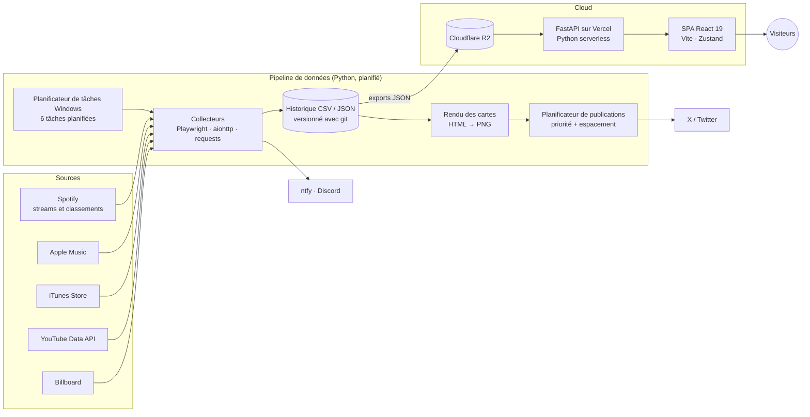

[English](README.md) · Français

# Swifties Charts

**Une plateforme de données en direct pour les fans de Taylor Swift : statistiques de streaming quotidiennes, classements mondiaux et jeux, mis à jour automatiquement chaque jour.**

🌐 **Site :** <https://thetsmuseum.app> · 𝕏 **@swiftiescharts**

> **Environ 100 000 visiteurs uniques depuis le lancement (mars 2026), selon Vercel Analytics.**

> 🔒 **Le code source est privé.** Ce dépôt est une vitrine. Je présente volontiers le code, l'architecture et les compromis en entretien.

*Page d'accueil. Chaque colonne correspond à une « ère » d'album ; le thème de couleur du site peut basculer sur n'importe laquelle.*

---

## Le problème

Les fans de Taylor Swift suivent ses chiffres de près : streams Spotify
quotidiens, positions dans les classements de dizaines de pays, classements
Apple Music et YouTube, paliers à venir comme « 1 milliard de streams ». Ces
données sont éparpillées sur de nombreuses plateformes. La plupart n'affichent
que les chiffres du jour sans garder d'historique, et aucune ne se concentre
sur une seule artiste.

**Swifties Charts** collecte tout cela chaque jour, conserve un historique
exact et le présente au même endroit, sur le site et dans des publications
quotidiennes en images sur X.

## Mon rôle

**J'ai conçu, développé et je fais tourner ce projet seul, de bout en bout :**
collecte des données, modèle de données, pipeline backend, API, frontend,
design de l'interface, génération d'images, déploiement, planification et
exploitation au quotidien.

## Fonctionnalités

### Pour les fans (visiteurs du site)
- **Streams Spotify** : streams quotidiens de chaque chanson et album, avec l'évolution d'un jour à l'autre et d'une semaine à l'autre, top chansons, top albums et bilans par période.
- **Classements Spotify** : positions, séries et meilleurs classements de chaque chanson dans le classement Global et chaque classement régional, avec l'historique complet.
- **Classements Apple Music, iTunes et YouTube** : classements par pays, actualisés toutes les heures pour Apple Music.
- **TayBoard** : un classement hebdomadaire composite que j'ai conçu, calculé à partir de Spotify, Apple Music, iTunes et YouTube.
- **Paliers** : prévisions de la date à laquelle une chanson atteindra 100 M / 1 Md / 2 Md de streams ou en dépassera une autre, plus un calculateur personnalisé.
- **Jeux** : duels de classement d'albums avec classements communautaires, quiz, jeu de paroles et jeu d'arcade.
- **12 langues**, thèmes de couleur par ère, et horaires affichés dans le fuseau horaire du visiteur.
- **Mobile d'abord** : la plupart des visiteurs viennent de leur téléphone, donc chaque page est conçue et vérifiée en largeur téléphone.

### Pour les abonnés sur X et Discord
- Publications quotidiennes automatiques avec des cartes générées en image : bilans de streams, entrées dans les classements, paliers atteints, records.
- Les publications sont mises en file par priorité et espacées selon les heures où l'audience est la plus active.
- Notifications Discord par canal et par rôle.

### Pour moi (exploitation)
- Une console d'administration protégée par jeton : réglages du site, thème par défaut, classements des jeux, actualités et annonces.
- Notifications push (ntfy) à chaque exécution des collecteurs, et une alerte quand un bucket de stockage approche de sa limite.

## Captures d'écran

| | |
|---|---|
|  *Streams Spotify du jour avec les plus fortes hausses.* |  *Position, série et meilleur classement d'une chanson dans chaque classement régional Spotify.* |
|  *Positions dans les classements Apple Music par pays, comparées d'heure en heure.* |  *TayBoard, le classement hebdomadaire composite, avec son score par plateforme.* |
|  *Prévisions de paliers et calculateur personnalisé.* |  *Vues YouTube quotidiennes, regroupées par chanson sur les vidéos officielles.* |
|  *L'espace jeux, trié par ère et par type de jeu.* |  *Duels de classement : choisis ta préférée pour construire ton propre classement.* |

### Mobile

| | | | |
|---|---|---|---|
|  |  |  |  |
| *Accueil, avec la barre d'onglets en bas.* | *Tableau des classements régionaux, réorganisé pour téléphone.* | *Filtres Apple Music, empilés.* | *TayBoard sous forme de cartes dépliables.* |

*Captures prises sur le site en ligne, avec des données réelles.*

## Architecture

Le projet est réparti sur deux dépôts privés :

| Dépôt | Contenu |
|---|---|
| `tsm-backend` | Collecteurs, historique des données, exports vers R2, génération d'images, publication sur X, notifications |
| `tsm-frontend` | Application React monopage et l'API FastAPI qui sert les données de R2 |

## Stack technique

| Domaine | Technologies |
|---|---|
| Frontend | React 19, React Router 7, Zustand, Chart.js, Vite 6, tokens de thème CSS, i18n en 12 langues |
| API | Python, FastAPI, Mangum, fonctions serverless Vercel |
| Pipeline de données | Python 3.13, Playwright, aiohttp, requests, pandas, Pillow, boto3 |
| Stockage | Cloudflare R2 (compatible S3), historique CSV/JSON versionné avec git |
| Hébergement et ops | Vercel, Planificateur de tâches Windows, ntfy, webhooks Discord |
| Analytics | Vercel Analytics et Speed Insights, API Google Search Console |

## Points techniques marquants

- **L'intégrité des données d'abord.** Une donnée fausse est pire qu'une donnée manquante. Si une source est en retard ou qu'un jour manque, le pipeline le marque en attente et réessaie ; il n'estime jamais. Un jour réellement manqué peut être réimporté depuis une source fiable. Des fichiers de verrou garantissent que chaque publication ne part qu'une fois, même si une tâche redémarre.
- **Collecte mondiale rapide.** Les classements régionaux sont récupérés en parallèle (aiohttp, sémaphores), avec temporisation en cas de limite de débit et nouvelles tentatives.
- **Cartes générées en image.** Les cartes sont construites comme des composants HTML/CSS et rendues en PNG avec Chromium headless. Chacune est vérifiée à la largeur ~310 px du fil X sur mobile avant d'être publiée.
- **Planification des publications.** Un registre partagé ordonne les publications par importance, garde un écart entre elles et les cale sur les pics d'activité de l'audience.
- **Performance de l'API.** Cache en périphérie (`s-maxage` + `stale-while-revalidate`), assets hachés immuables, et données d'historique lourdes chargées seulement quand une page en a besoin.
- **SEO pour une SPA.** La fonction serverless sert le squelette de l'application avec les balises meta et Open Graph propres à chaque page ; les images d'aperçu sont capturées automatiquement deux fois par jour.
- **Sécurité.** Les secrets sont dans des variables d'environnement. Les routes d'administration exigent un jeton. L'API a une limitation de débit et des limites de taille sur les points d'écriture publics.
- **Tests sans risque.** Les essais à blanc et les aperçus tournent dans un dossier bac à sable séparé avec des données simulées, si bien que les vraies données ne sont jamais mélangées aux données de test.

## En chiffres

*Comptés sur le code au 20/10/2026.*

| Indicateur | Valeur |
|---|---|
| Visiteurs uniques depuis le lancement | ~100 000 (Vercel Analytics) |
| Code du pipeline (Python) | ~132 000 lignes dans 353 fichiers |
| Code frontend | ~55 000 lignes de JSX, ~10 000 de JS, ~46 000 de CSS |
| Code de l'API (Python) | ~16 000 lignes |
| Pages du frontend | 69 |
| Modules de routes de l'API | 50 |
| Sources de données | 5 (Spotify, Apple Music, iTunes, YouTube, Billboard) |
| Tâches planifiées | 6 |
| Langues | 12 |
| Tests automatisés | 111 (60 Node, 51 Python) |
| Commits | ~2 800 sur les deux dépôts depuis mars 2026 |

## Contact

**Anas Sfar**
- LinkedIn : <https://www.linkedin.com/in/anas-sfar-331071370/>
- E-mail : <anassfar.fr@gmail.com>
- GitHub : [@AnasSfar](https://github.com/AnasSfar)

*Swifties Charts est un projet de fan indépendant, sans lien avec Taylor Swift, son label, Spotify, Apple ou YouTube.*
