English · [Français](README.fr.md)

# Swifties Charts

**A live data platform for Taylor Swift fans: daily streaming stats, worldwide charts and fan games, updated automatically every day.**

🌐 **Live site:** <https://thetsmuseum.app> · 𝕏 **@swiftiescharts**

> **About 100,000 unique visitors since launch (March 2026), per Vercel Analytics.**

> 🔒 **The source code is private.** This repository is a showcase only. I'm happy to walk through the code, the architecture and the trade-offs in an interview.

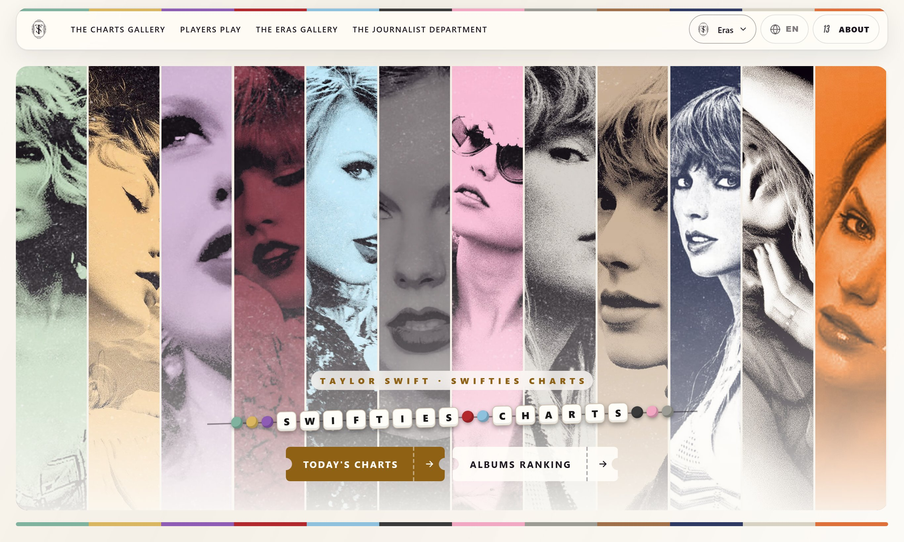
*Home page. Each column is one album "era"; the site's colour theme can switch to any of them.*

---

## The problem

Taylor Swift fans follow her numbers closely: daily Spotify streams, chart
positions in dozens of countries, Apple Music and YouTube rankings, upcoming
milestones like "1 billion streams". That data is scattered across many
platforms. Most of them only show today's numbers and keep no history, and
none of them focus on one artist.

**Swifties Charts** collects all of it every day, keeps an exact history,
and presents it in one place on the website and in daily image posts on X.

## My role

**I designed, built and run this project alone, end to end:** data
collection, data model, backend pipeline, API, frontend, UI design,
image generation, deployment, scheduling and day-to-day operations.

## Features

### For fans (website visitors)
- **Spotify Streams**: daily streams for every song and album, with day-over-day and week-over-week change, top songs, top albums and period recaps.
- **Spotify Charts**: positions, streaks and peaks for each song on the Global chart and every regional chart, plus a full chart history.
- **Apple Music, iTunes and YouTube charts**: rankings per country, refreshed every hour for Apple Music.
- **TayBoard**: a weekly composite chart I designed, scored from Spotify, Apple Music, iTunes and YouTube.
- **Milestones**: forecasts of when a song will reach 100M / 1B / 2B streams or overtake another song, plus a custom calculator.
- **Games**: album ranking battles with community leaderboards, quizzes, a lyrics game and an arcade game.
- **12 languages**, era-based colour themes, and times shown in the visitor's own time zone.
- **Mobile-first**: most visitors come from their phones, so every page is designed and checked at phone width.

### For followers on X and Discord
- Automated daily posts with generated image cards: stream recaps, chart debuts, milestones reached, records.
- Posts are queued by priority and spaced out according to when the audience is most active.
- Discord notifications by channel and role.

### For me (operator)
- A token-protected admin console: site settings, default theme, game leaderboards, news and announcements.
- Push notifications (ntfy) on collector runs, and an alert when a storage bucket nears its limit.

## Screenshots

| | |
|---|---|
| 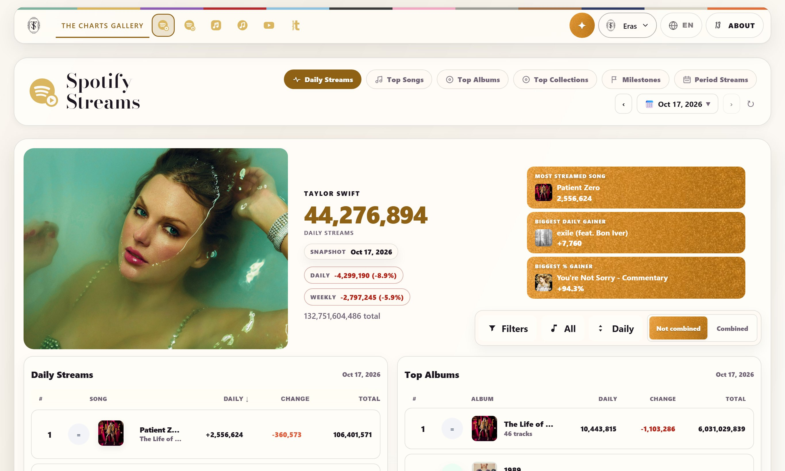 *Daily Spotify streams with the day's biggest gainers.* | 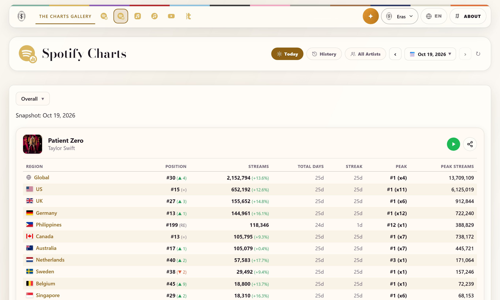 *A song's position, streak and peak on each Spotify regional chart.* |
| 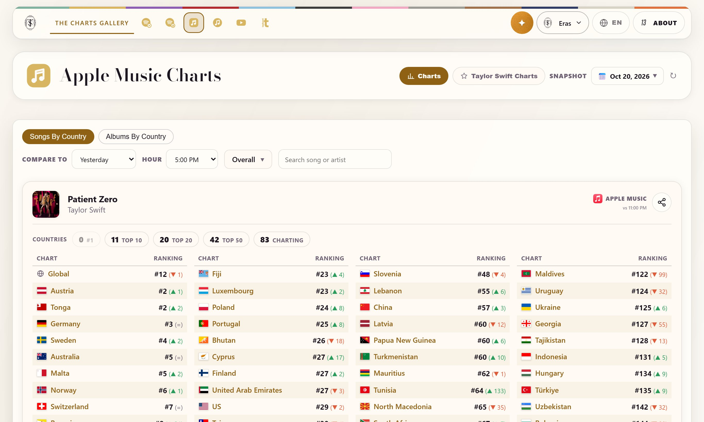 *Apple Music chart positions by country, compared hour to hour.* | 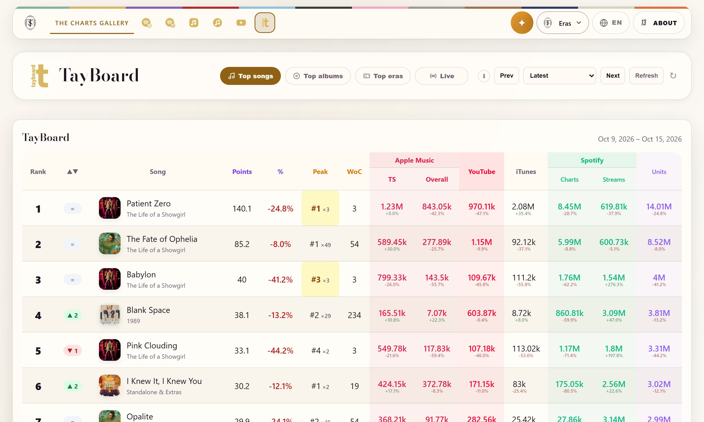 *TayBoard, the composite weekly chart, with its score per platform.* |
| 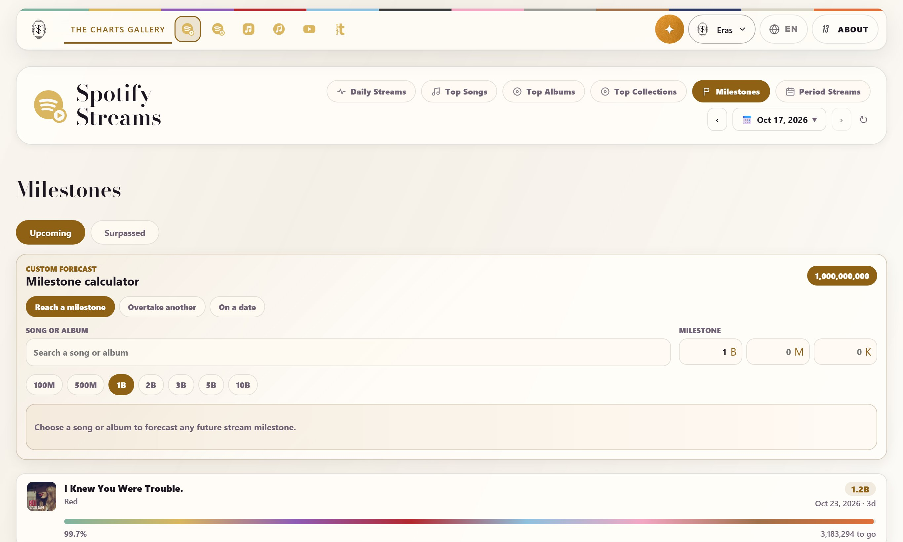 *Milestone forecasts and the custom calculator.* | 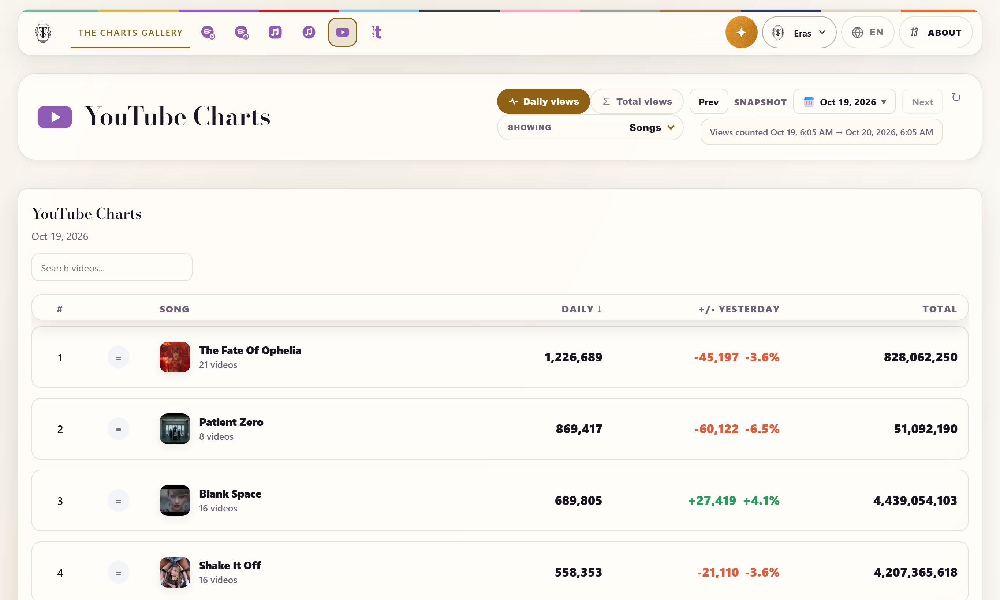 *Daily YouTube views, grouped by song across official videos.* |
| 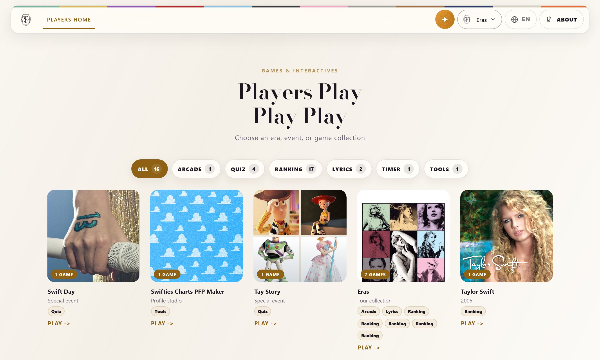 *The games hub, sorted by era and game type.* | 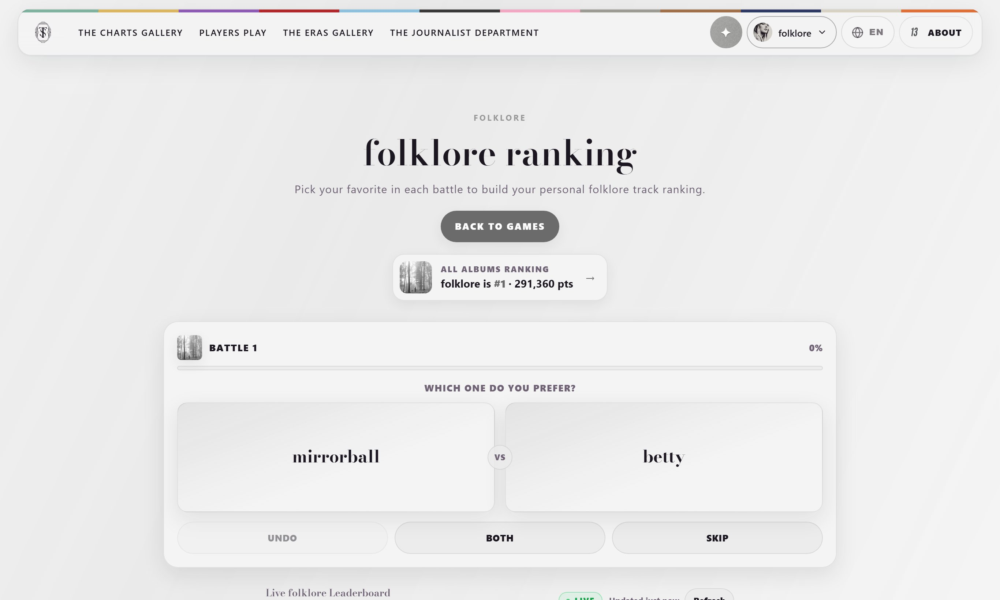 *Ranking battles: pick your favourite to build your personal ranking.* |

### Mobile

| | | | |
|---|---|---|---|
| 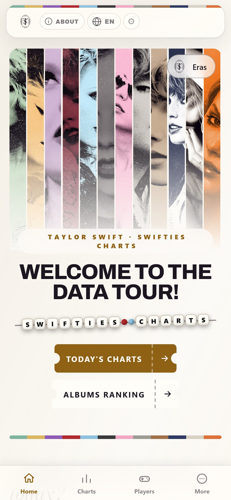 | 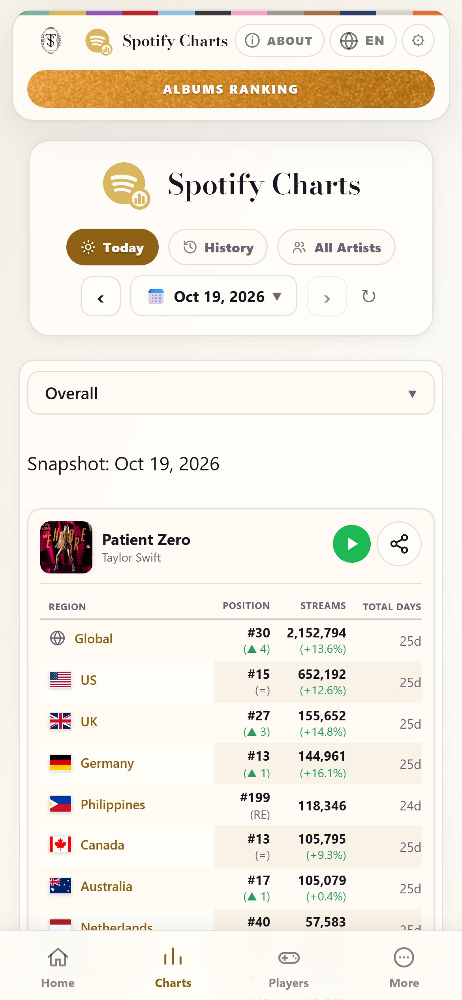 | 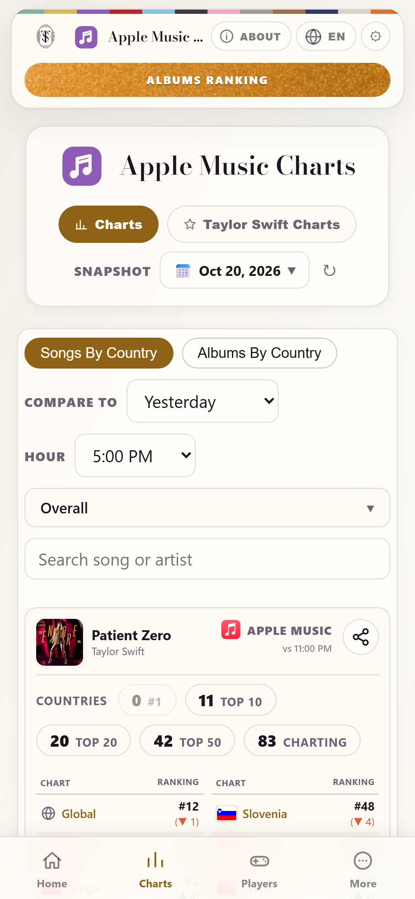 | 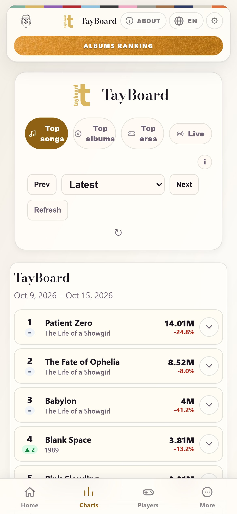 |
| *Home, with the bottom tab bar.* | *Regional chart table, reflowed for phones.* | *Apple Music filters, stacked.* | *TayBoard as expandable cards.* |

*Screenshots were taken from the live site with real data.*

## Architecture

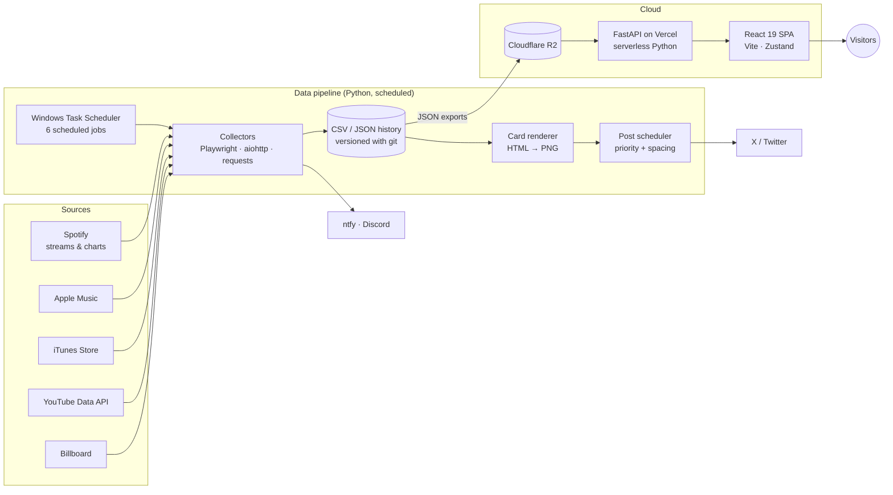

The project is split into two private repositories:

| Repository | Content |
|---|---|
| `tsm-backend` | Collectors, data history, exports to R2, image generation, posting to X, notifications |
| `tsm-frontend` | React single-page app and the FastAPI API that serves R2 data |

## Tech stack

| Area | Technologies |
|---|---|
| Frontend | React 19, React Router 7, Zustand, Chart.js, Vite 6, CSS theme tokens, 12-language i18n |
| API | Python, FastAPI, Mangum, Vercel serverless functions |
| Data pipeline | Python 3.13, Playwright, aiohttp, requests, pandas, Pillow, boto3 |
| Storage | Cloudflare R2 (S3-compatible), CSV/JSON history versioned with git |
| Hosting & ops | Vercel, Windows Task Scheduler, ntfy, Discord webhooks |
| Analytics | Vercel Analytics & Speed Insights, Google Search Console API |

## Technical highlights

- **Data integrity first.** Wrong data is worse than missing data. If a source is late or a day is missing, the pipeline marks it as pending and retries; it never estimates. A day that was truly missed can be re-imported from a trusted source. Lock files make sure each post is published only once, even when a job is restarted.
- **Fast worldwide collection.** Regional charts are fetched concurrently (aiohttp, semaphores) with rate-limit backoff and retries.
- **Generated image cards.** Cards are built as HTML/CSS components and rendered to PNG with headless Chromium. Each one is checked at the ~310px width of the mobile X timeline before it is posted.
- **Post scheduling.** A shared registry orders posts by importance, keeps gaps between them, and times them to the audience's activity peaks.
- **API performance.** Edge caching (`s-maxage` + `stale-while-revalidate`), immutable hashed assets, and heavy history data loaded only when a page needs it.
- **SEO for a SPA.** The serverless function serves the app shell with per-page meta and Open Graph tags; preview images are captured automatically twice a day.
- **Security.** Secrets live in environment variables. Admin routes need a token. The API has rate limiting and size limits on public write endpoints.
- **Safe testing.** Dry runs and previews run in a separate sandbox folder with simulated data, so real data never gets mixed with test data.

## By the numbers

*Counted from the code on 2026-10-20.*

| Metric | Value |
|---|---|
| Unique visitors since launch | ~100,000 (Vercel Analytics) |
| Pipeline code (Python) | ~132,000 lines in 353 files |
| Frontend code | ~55,000 lines of JSX, ~10,000 of JS, ~46,000 of CSS |
| API code (Python) | ~16,000 lines |
| Frontend pages | 69 |
| API route modules | 50 |
| Data sources | 5 (Spotify, Apple Music, iTunes, YouTube, Billboard) |
| Scheduled jobs | 6 |
| Languages | 12 |
| Automated tests | 111 (60 Node, 51 Python) |
| Commits | ~2,800 across both repositories since March 2026 |

## Contact

**Anas Sfar**
- LinkedIn: <https://www.linkedin.com/in/anas-sfar-331071370/>
- E-mail: <anassfar.fr@gmail.com>
- GitHub: [@AnasSfar](https://github.com/AnasSfar)

*Swifties Charts is an independent fan project and is not affiliated with Taylor Swift, her label, Spotify, Apple or YouTube.*
